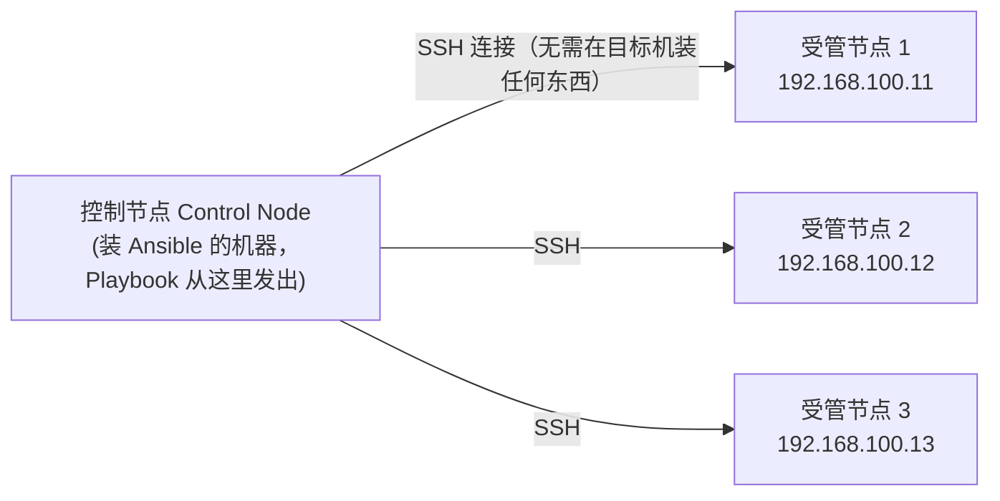
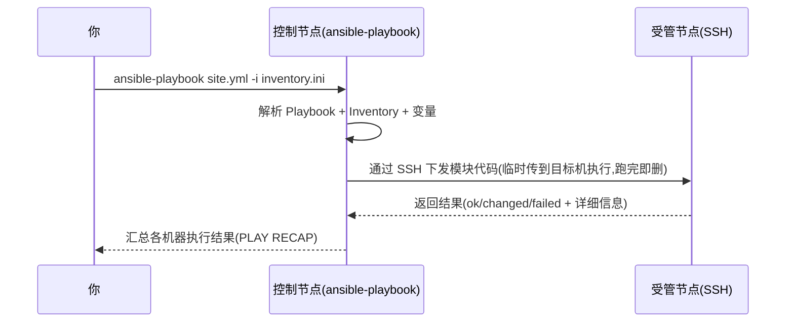

# 第 1 篇 · 初识 Ansible

> 本篇零操作。读完你将明白：为什么需要 Ansible，它的三大特性，控制节点/受管节点的架构，以及 inventory、模块、Playbook、Role、Collection、执行环境（EE）这些概念各自指什么。

---

## 一、从一个常见的痛苦场景说起

假设你是团队新来的运维/后端，接到任务："在 10 台服务器上部署 MySQL。"手工流程大概是：

1. 逐台 SSH 登录，执行 `apt install mysql-server`；
2. 逐台改 `/etc/mysql/mysql.conf.d/mysqld.cnf`（改 bind-address、字符集……）；
3. 逐台 `systemctl restart mysql`、验证端口、建库建用户；
4. 一台机器系统版本不同？命令重来。某台忘了改配置？排查半天。

10 台尚可忍受，100 台呢？半年后要统一升级配置呢？**人肉操作不可重复、易遗漏、无记录**——这是所有自动化运维工具要解决的问题。

Ansible 的答案是：**把"部署一台机器"的全部动作写成 YAML 文件（Playbook），然后一条命令推向 N 台机器**。文件放在 Git 里可评审、可回滚、可复用；执行过程幂等——跑一遍和跑十遍的结果一样。

## 二、Ansible 是什么

[Ansible](https://docs.ansible.com/ansible/latest/) 是一个开源的**自动化运维工具**（Red Hat 主导，2015 年被收购，Python 编写），能做的事覆盖运维全流程：

- **配置管理**：装软件、改配置、管用户、管文件（本系列的重点）；
- **应用部署**：构建产物分发、滚动重启；
- **编排**：多机多步骤任务的先后协调（如"先停服务→换包→再启动"）。

它的三个核心设计决定了它的性格：

| 特性 | 是什么 | 对你的意义 |
| --- | --- | --- |
| **无代理（Agentless）** | 受管机器上**不需要装任何 Ansible 组件**，走标准 SSH（Windows 走 WinRM） | 零侵入、无版本包袱；能 SSH 登录就能管 |
| **幂等（Idempotent）** | 模块描述"目标状态"而非"执行动作"——软件已装好就跳过、配置已是目标值就不改 | 重复执行安全，天然适合"对齐到期望状态" |
| **声明式（Declarative）** | 你写"要什么结果"，而不是"怎么做" | 可读、可评审，像写文档一样写运维 |

"幂等"值得展开一句：用 shell 脚本 `apt install mysql` 跑十遍，脚本可能反复折腾甚至报错；而 Ansible 的 `apt` 模块看到 MySQL 已装好，直接返回 `ok` 什么都不做。**把"变化"压到最小，是 Ansible 与"一堆 shell 命令"的本质区别。**

## 三、架构：控制节点 + 受管节点

| 角色 | 是什么 | 系统要求 |
| --- | --- | --- |
| **控制节点（Control Node）** | 装 Ansible、存放 Playbook、发起执行的机器 | Linux/macOS（**Windows 不支持原生安装**，需 WSL2，见第 2 篇） |
| **受管节点（Managed Node）** | 被管理的服务器，在 inventory 里登记 | Linux（SSH）或 Windows（WinRM） |

## 四、核心概念全景

按"你在日常使用中遇到的顺序"来认识它们：

| 概念 | 是什么 | 一句话类比 |
| --- | --- | --- |
| **Inventory（清单）** | 一份机器名单文件（IP/主机名 + 分组 + 变量），默认在 `/etc/ansible/hosts` 或项目内 `inventory.ini` | 通讯录："web 组有这 3 台，db 组有那 2 台" |
| **Module（模块）** | 完成一件小事的"标准零件"：装软件（apt/yum）、传文件（copy/template）、管服务（service）、管用户（user）……官方内置数千个 | 螺丝刀、扳手、锤子 |
| **Ad-hoc 命令** | 一行命令直接调一个模块：`ansible all -m ping` | 临时使唤一下扳手 |
| **Playbook（剧本）** | 把多个任务（Task）按顺序编排成的 YAML 文件，是主力交付物 | 施工说明书 |
| **Role（角色）** | 把"部署某个东西"的任务、模板、变量、文件打包成标准目录结构，可复用可分享 | 一整套标准化施工包 |
| **Collection（集合）** | 模块/Role/插件的发行包，如 `community.mysql`，用 `ansible-galaxy collection install` 安装 | 零件的"品牌系列套装" |
| **执行环境（Execution Environment, EE）** | 把 Ansible + 指定版本的集合 + Python 依赖打进一个**容器镜像**，实现"控制节点环境容器化" | 移动式的标准化工具车（官方新入门指南的主题，见下节） |

一次典型执行的数据流：

理解"模块是临时推送到目标机执行的 Python 代码"这一点，就明白了为什么目标机只需要有 Python + SSH。

## 五、执行环境（EE）：官方新入门指南讲的东西

你参考的官方教程 [Getting Started with Execution Environments](https://docs.ansible.org.cn/projects/ansible/latest/getting_started_ee/index.html) 讲的就是 **EE（执行环境）**：把 ansible-core、ansible-runner、集合、Python 依赖一起打进容器镜像，作为"容器化的控制节点"。

为什么要有 EE？传统方式下，控制节点上 Ansible 版本、集合版本、Python 库互相牵扯（"A 集合要 py3 的某个库，B 集合冲突了"）；EE 把这些**封装进镜像**，做到：

- **环境可复制**：团队所有人/所有 CI 流水线用同一个镜像，行为完全一致；
- **依赖隔离**：不同项目用不同 EE，互不污染；
- **开箱即用**：官方提供 `community-ee-minimal`（精简）、`community-ee-base`（完整）等社区镜像，`ansible-navigator` 工具直接在其上运行命令。

**本系列的取舍**：学习与中小团队场景，直接在控制节点 pip 安装最简单（第 2 篇路线 A）；EE 作为路线 B 给出官方用法，等你需要团队级标准化时再启用。两条路线写的 Playbook **完全一样**，随时可以切换。

## 六、和"同类"工具的关系

| 对比项 | Ansible | Shell 脚本 | SaltStack | Terraform |
| --- | --- | --- | --- | --- |
| 学习门槛 | 低（YAML + Linux 基础） | 低 | 中 | 中（HCL） |
| 无代理 | ✅ SSH | ✅ | ❌ 需装 Agent | ✅ API 驱动 |
| 幂等性 | 内置 | 自己保证 | 内置 | 内置 |
| 定位 | 配置管理 + 编排 | 一切手工的脚本化 | 配置管理（大集群） | **基础设施资源**（云主机/网络/VPC）的声明式管理 |

一句话区分 Ansible 与 Terraform：Terraform 管"**造机器和云资源**"，Ansible 管"**机器造好之后里面装什么、怎么配**"。两者常配合使用。

## 七、小结

- Ansible = 无代理（SSH）+ 幂等 + 声明式的自动化运维工具；
- 架构 = 控制节点（发起）+ 受管节点（被管，零安装）；
- 概念链：**inventory 登记机器 → module 干单件活 → ad-hoc 临时调模块 → Playbook 编排成套 → Role 打包复用 → Collection 分发 → EE 容器化整个环境**；
- Windows 控制节点要走 WSL2；官方新入门指南的 EE 是"容器化控制节点"，玩法不同但 Playbook 通用。

下一篇动手：装 Ansible、配 SSH、登记机器名单，用一条命令"点亮"你的服务器。

---

*导航：[README](README.md) · 上一篇：无 · 下一篇：[02-安装与连通](02-安装与连通.md)*
